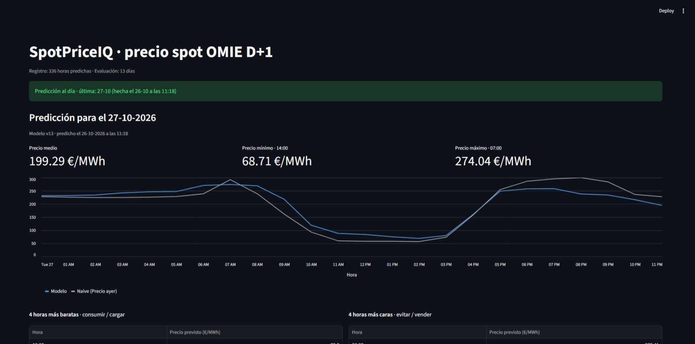
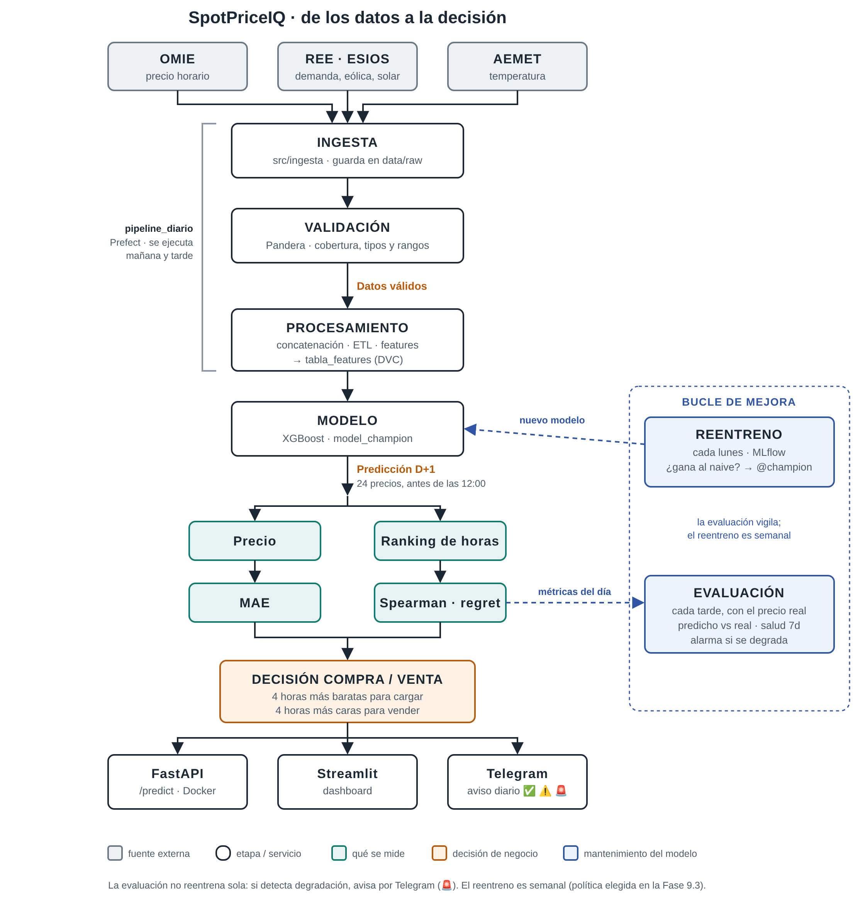
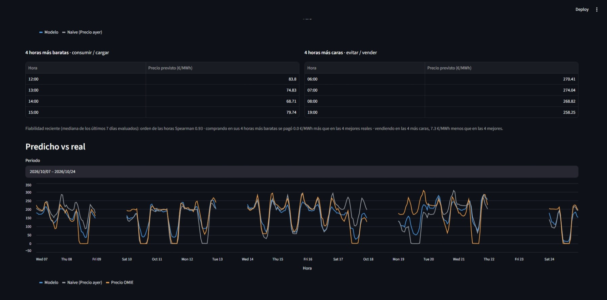
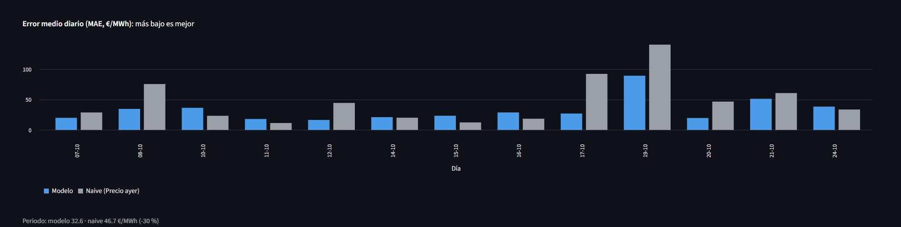
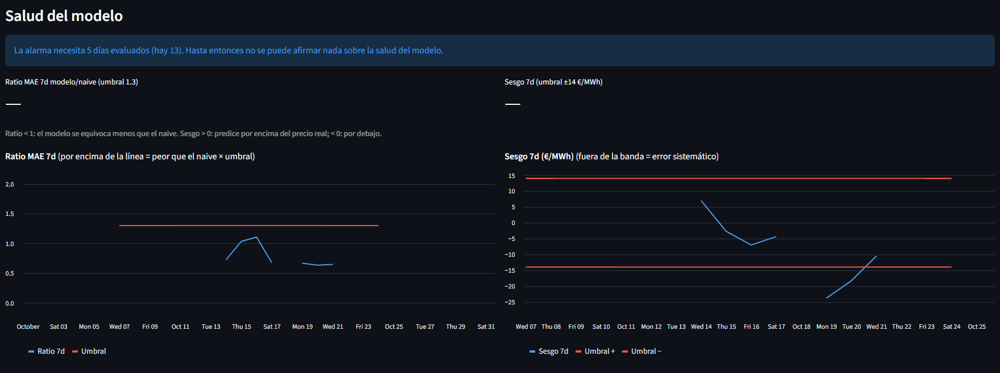
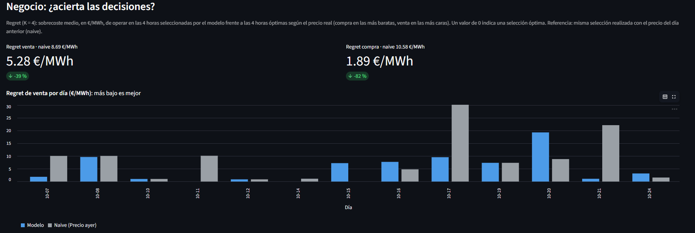

# SpotPriceIQ — Predicción del precio spot eléctrico español (OMIE D+1)


**Sistema de machine learning en producción que predice cada mañana, antes del cierre de la subasta de OMIE, las 24 horas de precio del día siguiente, y las traduce en una decisión: en qué horas comprar (cargar una batería) y en cuáles vender.**

Trabajo Fin de Máster · Data Science. Funciona a diario desde octubre de 2026 con datos públicos (OMIE, REE/ESIOS, AEMET).



---

## Resultados clave

| | Modelo | Naive (precio de ayer) | Mejora |
|---|---|---|---|
| **Backtesting walk-forward** (34 meses, MAE €/MWh) | **17,21** | 19,38 | **−11 %** |
| **Producción real** (13 días evaluados, oct-2026, MAE €/MWh) | **32,6** | 46,7 | **−30 %** |
| **Decisión de venta** (regret K = 4, €/MWh) | **5,28** | 8,69 | **−39 %** |
| **Decisión de compra** (regret K = 4, €/MWh) | **1,89** | 10,58 | **−82 %** |

- **Caso de negocio:** para una batería de 1 MW / 4 MWh, operar con el modelo en lugar del naive **reduce un 41 % las pérdidas** frente a la operación perfecta, unos **5.600 € al año por MW** (simulación de 635 días; los primeros días de producción dan un 38 %, coherente).
- **¿Hace falta un modelo complejo?** Se comparó con modelos simples en igualdad de condiciones: XGBoost (17,21) gana a la regresión lineal (18,29) y a un árbol de decisión (20,03). La complejidad está justificada, pero por un margen moderado (≈ 6 % sobre la lineal). → [`notebooks/06_modelos_simples.ipynb`](notebooks/06_modelos_simples.ipynb)
- **Reentrenar importa:** en la simulación de políticas, el modelo congelado apenas mejora al naive (−3 %) y se hunde en el verano de 2026; reentrenando cada semana la mejora sube al −17 %. Por eso el sistema reentrena todos los lunes.

> El error de producción (32,6) es mayor que el del backtesting porque octubre de 2026 es un mes especialmente volátil. Lo que se mantiene es la **ventaja frente al naive**, que es lo que mide si el modelo aporta valor.

### Enfoque del proyecto

El objetivo no es exprimir el último euro de MAE, sino construir el sistema completo que haría falta en una empresa: datos validados, evaluación sin leakage, despliegue diario, monitorización y una métrica que se traduce en decisiones. El modelo ya bate al baseline con margen, y hay mejoras de precisión conocidas que no se han incorporado por alcance:

- **Precio del gas (MIBGAS):** en muchas horas el precio marginal lo fija un ciclo combinado, así que el gas es probablemente la variable que más falta.
- **Precio del CO₂ (derechos de emisión EUA):** también forma parte del coste de los ciclos combinados.
- **Previsiones meteorológicas reales**, publicadas antes de la subasta, en lugar de la observación de AEMET con 3 días de retraso.
- **Previsiones de demanda y de generación solar** con hora de publicación verificada: se descartaron por riesgo de leakage, no porque no aporten.

Todas encajan en la arquitectura actual: serían un cliente de ingesta más, su contrato de validación y sus features.

---

## Arquitectura



| Etapa | Qué hace | Dónde |
|---|---|---|
| **Ingesta** | Descarga precio (OMIE), demanda y previsión eólica (REE/ESIOS) y meteorología de 16 estaciones (AEMET) | `src/ingesta/` |
| **Validación** | Contratos de datos con Pandera y control de cobertura y frescura de cada fuente. OMIE y ESIOS bloquean el pipeline; AEMET solo avisa | `src/validation/` |
| **Procesamiento** | Une las tres fuentes en un índice horario UTC (días de 23 y 25 h incluidos), limpia y crea 97 features sin leakage | `src/procesamiento/` |
| **Modelo** | XGBoost registrado en MLflow como `@champion` y exportado a `model_champion/` | `model_champion/` |
| **Orquestación** | Flujos de Prefect lanzados por el Programador de tareas de Windows | `src/orquestacion/` |
| **Monitorización** | Predicho vs real cada tarde: MAE, Spearman, regret, sesgo y salud a 7 días con alarma | `src/monitorizacion/` |
| **Servicio** | API FastAPI (`/predict`, `/health`, `/model-info`) en Docker y dashboard en Streamlit | `src/api/`, `src/dashboard/` |
| **Avisos** | Telegram: ✅ predicción hecha, ⚠️ fuente no crítica desactualizada, 🚨 fallo o alarma | `src/notificaciones/` |

---

## Cómo funciona en producción

| Hora (Madrid) | Flujo | Qué hace |
|---|---|---|
| **11:15** | `prediccion_manana` | Ingesta y validación → features → predice las 24 horas de mañana. Si son más de las 11:50 no predice: la subasta ya ha cerrado |
| **14:30** | `evaluacion_tarde` | Con el precio real ya publicado, compara predicho vs real y actualiza la salud del modelo |
| **Lunes 10:00** | `reentrenamiento` | Reentrena con todos los datos, registra en MLflow y promociona a `@champion` solo si gana al naive |

Cada predicción queda guardada con la versión del modelo y la hora a la que se hizo, para poder auditar después qué se sabía y cuándo.

**Calidad del código:** 37 tests con pytest y Ruff obligatorio, ejecutados en GitHub Actions en cada push.

<details>
<summary><b>Más capturas del dashboard</b></summary>

**Predicho vs real**


**Error diario: modelo vs naive**


**Salud del modelo**


**Negocio: ¿acierta las decisiones?**


</details>

---

## Decisiones que marcan la diferencia

- **Auditoría *point-in-time*.** Cada feature usa solo lo que se sabía antes del cierre de la subasta (12:00 del día anterior). La meteorología observada entra con 3 días de retraso, y de ESIOS solo se usa la previsión eólica D+1, cuya hora de publicación se verificó. Quitar ese leakage empeoró el MAE, y se reporta el número honesto.
- **Imputación de huecos de AEMET en tres capas**, la segunda con una **estación donante elegida por correlación** y un control de solape para evitar correlaciones espurias.
- **Walk-forward mensual expanding** en lugar de un único train/test: mide el error como si el modelo se hubiera usado cada mes.
- **Métricas de negocio, no solo de error:** el *regret* mide cuántos €/MWh se pierden por elegir las horas del modelo en lugar de las óptimas.
- **Degradación controlada:** si falla una fuente no crítica (AEMET) el sistema sigue imputando y avisa; si falla una crítica, se para y avisa.

---

## Limitaciones y trabajo futuro

**Limitaciones conocidas**

- **Corre en un portátil.** Si está apagado o en reposo a las 11:15 se pierde la predicción del día (ha pasado varias veces en octubre). Además, los huecos dejan ciega la alarma de salud, que necesita 5 días evaluados en los últimos 7.
- **Los intervalos de predicción se quedan cortos:** cubren el 51 % de los casos para un nominal del 80 %. Por eso no están en producción.
- **La promoción del reentreno solo compara con el naive**, no con el champion actual: el champion tiene datos más recientes que la copia que se puede validar, y la comparación justa necesitaría *shadow mode*.
- **La LSTM no se recalculó** con los datos actuales (16,59 ± 7,96 en septiembre, sobre otro periodo).

**Trabajo futuro**

- Incorporar las variables de [Enfoque del proyecto](#enfoque-del-proyecto), empezando por MIBGAS.
- Llevar la orquestación a la nube (GitHub Actions programado y un repositorio de datos aparte), con el diseño ya documentado en el diario.
- *Shadow mode* para comparar el nuevo modelo con el champion antes de promocionarlo.
- Calibrar los intervalos con predicción conformal.
- Automatizar el informe de drift (hoy se lanza a mano con Evidently).
- Comparar los modelos también por regret y explorar un *gating* XGBoost / LSTM.

---

## Cómo reproducirlo

Requisitos: Python 3.11, claves gratuitas de [ESIOS](https://www.esios.ree.es/es/pagina/api) y [AEMET OpenData](https://opendata.aemet.es/) y, opcionalmente, un bot de Telegram.

```bash
git clone https://github.com/jaime570/SpotPriceIQ.git
cd SpotPriceIQ
python -m pip install -r requirements.txt
```

Crea un fichero `.env` en la raíz (no se sube a git):

```
ESIOS_API_KEY=...
AEMET_API_KEY=...
TELEGRAM_TOKEN=...      # opcional
TELEGRAM_CHAT_ID=...    # opcional
```

| Acción | Comando |
|---|---|
| Recuperar el dataset versionado | `python -m dvc pull` |
| Predicción de mañana | `python -m src.orquestacion.prediccion_manana` |
| Evaluación de hoy | `python -m src.orquestacion.evaluacion_tarde` |
| Reentrenamiento | `python -m src.orquestacion.reentrenamiento` |
| Dashboard | `python -m streamlit run src/dashboard/app.py` → http://localhost:8501 |
| API (local) | `python -m uvicorn src.api.main:app --reload` → http://127.0.0.1:8000/docs |
| API + MLflow (Docker) | `docker compose up` → API en http://localhost:8001, MLflow en http://localhost:5000 |
| Tests | `python -m pytest` |

En Windows, para lanzar los flujos a mano: `$env:PREFECT_PROFILE="ephemeral"`.

---

## Estructura del repositorio

```
SpotPriceIQ/
├── src/
│   ├── ingesta/          clientes OMIE, ESIOS y AEMET
│   ├── validation/       contratos Pandera y control de cobertura
│   ├── procesamiento/    concatenación, ETL y features
│   ├── features/         lista oficial de features
│   ├── evaluacion/       métricas y walk-forward
│   ├── monitorizacion/   predicción D+1, evaluación diaria, simulación de reentreno, drift
│   ├── orquestacion/     flujos de Prefect (mañana, tarde, reentreno)
│   ├── notificaciones/   avisos por Telegram
│   ├── api/              FastAPI
│   └── dashboard/        Streamlit
├── notebooks/            01–15: del análisis exploratorio al caso de negocio
├── tests/                pytest
├── model_champion/       modelo en producción (exportado de MLflow)
├── data/                 raw · interim · processed · monitoring (versionado con DVC)
├── reports/              resultados de evaluación y caso de negocio
├── script/               .bat del Programador de tareas
└── docs/                 diario de aprendizaje e imágenes
```

| Notebook | Contenido |
|---|---|
| 01–04 | Ingesta, concatenación, ETL y features |
| 05 | Baseline naive y walk-forward |
| 06 | Modelos simples: lineal y árbol frente a XGBoost |
| 07–08 | XGBoost e intervalos de predicción |
| 09 / 09b | LSTM |
| 10 | Interpretabilidad (SHAP) |
| 11–13 | Monitorización, auditoría *point-in-time* y política de reentreno |
| 14–15 | Dashboard y caso de negocio |

**El [diario de aprendizaje](docs/diario.md)** recoge cada decisión, experimento descartado e incidente de producción, con fecha.

---

**Autor:** Jaime Llorca Martínez · [GitHub](https://github.com/jaime570)
